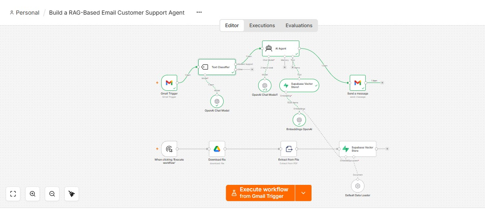

# 📧 RAG-Based Email Customer Support Agent

An **n8n** workflow that automatically reads incoming customer emails, decides whether they are support questions, and replies with accurate answers pulled from your own company documents using **RAG (Retrieval-Augmented Generation)**.

> Example use case: an education consultancy where students email about registration fees, consultancy fees, refund policy and their responsibilities.



---

## ✨ Features

- **Automatic inbox monitoring** – Gmail Trigger checks for new emails every minute.
- **Smart email classification** – a Text Classifier separates real *Student Support* questions from spam, newsletters, receipts and personal mail.
- **Knowledge-grounded answers** – the AI Agent searches a Supabase vector store and answers *only* from your documents.
- **No hallucination** – if the answer isn't in the knowledge base, the agent politely says a human will follow up.
- **Ready-to-send replies** – complete email with subject, greeting, body and sign-off, sent back via Gmail.
- **Easy knowledge updates** – upload a new PDF to Google Drive and run the ingestion flow to refresh the knowledge base.

---

## 🏗️ How It Works

The workflow has two parts.

### 1. Knowledge Base Ingestion (run manually, once or when documents change)

```
Manual Trigger → Google Drive (Download PDF) → Extract from File (PDF) → Supabase Vector Store (Insert)
                                                                            ↑            ↑
                                                                  OpenAI Embeddings   Default Data Loader
```

1. Downloads your company policy PDF from Google Drive.
2. Extracts the text from the PDF.
3. Splits it into chunks and creates embeddings with OpenAI.
4. Stores the vectors in the Supabase `documents` table.

### 2. Email Support Agent (runs automatically)

```
Gmail Trigger → Text Classifier ──(Student Support)──→ AI Agent → Gmail (Send Reply)
                                 └─(Other)──→ ignored       ↑
                                                  OpenAI Chat Model + Supabase Vector Store (tool)
```

1. **Gmail Trigger** polls for new emails every minute.
2. **Text Classifier** labels each email as `Student Support` or `Other`.
3. **AI Agent** (GPT‑5‑mini) searches the Supabase vector store for relevant policy information.
4. The agent drafts a complete, friendly reply.
5. **Gmail** sends the reply to the original sender with subject `Re: <original subject>`.

---

## 🧰 Tech Stack

| Component | Purpose |
|-----------|---------|
| [n8n](https://n8n.io) | Workflow automation |
| OpenAI (GPT‑5‑mini) | Classification and reply generation |
| OpenAI Embeddings | Converting text into vectors |
| Supabase (pgvector) | Vector database / knowledge base |
| Gmail API | Receiving and sending emails |
| Google Drive | Storing the source PDF |

---

## 📁 Repository Structure

```
.
├── README.md
├── images/
│   └── workflow-screenshot.jpg
└── workflow/
    └── rag-email-support-agent.json   # n8n workflow (credentials removed)
```

---

## 🚀 Setup Guide

### Prerequisites

- An n8n instance (cloud or self-hosted)
- OpenAI API key
- Supabase project with the **pgvector** extension enabled
- Google account (Gmail + Google Drive access)

### Step 1 – Prepare Supabase

Run this in the Supabase SQL editor to create the vector table and the match function used by n8n:

```sql
create extension if not exists vector;

create table documents (
  id bigserial primary key,
  content text,
  metadata jsonb,
  embedding vector(1536)
);

create function match_documents (
  query_embedding vector(1536),
  match_count int default null,
  filter jsonb default '{}'
) returns table (
  id bigint,
  content text,
  metadata jsonb,
  similarity float
)
language plpgsql
as $$
begin
  return query
  select
    id,
    content,
    metadata,
    1 - (documents.embedding <=> query_embedding) as similarity
  from documents
  where metadata @> filter
  order by documents.embedding <=> query_embedding
  limit match_count;
end;
$$;
```

### Step 2 – Import the workflow

1. In n8n, click **Workflows → Import from File**.
2. Select `workflow/rag-email-support-agent.json`.

### Step 3 – Add your credentials

The exported JSON contains **no credentials**. After importing, connect your own accounts in each node:

| Node | Credential needed |
|------|-------------------|
| Download file | Google Drive OAuth2 |
| Embeddings OpenAI | OpenAI API |
| Supabase Vector Store / Supabase Vector Store1 | Supabase API |
| OpenAI Chat Model / OpenAI Chat Model1 | OpenAI API |
| Gmail Trigger / Send a message | Gmail OAuth2 |

### Step 4 – Set your document

In the **Download file** node, replace the placeholder `YOUR_GOOGLE_DRIVE_FILE_ID` with the file picked from your own Google Drive (the PDF containing your company policies / FAQs).

### Step 5 – Load the knowledge base

Click **Execute workflow** on the *Manual Trigger* to run the ingestion flow. Check the `documents` table in Supabase to confirm the rows were created.

### Step 6 – Activate

Customise the classifier categories and the agent prompt for your business (see below), then **activate** the workflow so it runs automatically.

---

## ⚙️ Customisation

- **Categories** – edit the *Text Classifier* categories and descriptions to match your own email types.
- **Agent prompt** – edit the *AI Agent* system prompt to change tone, language or sign-off.
- **Model** – swap `gpt-5-mini` for any other chat model supported by n8n.
- **Polling interval** – change the *Gmail Trigger* poll time (default: every minute).
- **Human review** – replace *Send a message* with a Gmail **Create Draft** node if you want to approve replies before they go out.

---

## ⚠️ Notes & Limitations

- The classifier currently reads only the email **snippet**, not the full body. Switch to the full body for longer emails.
- Emails classified as `Other` are not handled (no further action).
- Re-running ingestion on the same document will insert duplicate vectors; clear the table first when updating.
- Always test with a separate inbox before connecting a live one.

---

## 🔒 Security

This repository contains **no API keys, tokens, or credential IDs**. Never commit your own secrets. Configure all credentials inside n8n only.

---

## 👤 Author

**Anupom Mojumder** – AI Automation Engineer
📧 anupommojumder950@gmail.com
🔗 [LinkedIn](https://linkedin.com/in/anupommojumder)

---

## 📄 License

Free to use and adapt for learning and personal projects.
